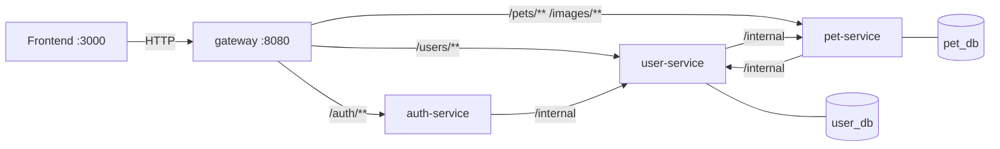

# 🐾 Pet Crud (AdotaPet)

Sistema web CRUD para gerenciamento e adoção de pets, desenvolvido como projeto de estudo. A aplicação é dividida em **frontend** (React) e **backend em microserviços** (Spring Boot: gateway, auth, user e pet), com **PostgreSQL** como banco de dados, e tudo pronto para rodar via **Docker**. Utilizo este projeto para aplicar conceitos e tecnologias que venho estudando.

## 📑 Sumário

- [Visão geral](#-visão-geral)
- [Frontend](#-frontend)
- [Backend (microserviços)](#-backend-microserviços)
- [Banco de dados](#-banco-de-dados)
- [Como rodar com Docker](#-como-rodar-com-docker)
- [Variáveis de ambiente](#-variáveis-de-ambiente)
- [Estrutura do repositório](#-estrutura-do-repositório)
- [Licença](#-licença)

## 🔎 Visão geral

O projeto permite cadastrar, listar, buscar, atualizar e remover pets (com upload de imagem), além de contar com autenticação de usuários (login/registro) e uma área administrativa. A comunicação entre frontend e backend acontece via API REST, e a orquestração completa (frontend + backend + banco) é feita com Docker Compose.

## 🖥️ Frontend

Aplicação **React + TypeScript**, criada com **Vite** e estilizada com **Tailwind CSS** + componentes **shadcn/ui** (baseados em Radix UI).

**Principais tecnologias:**
- React 18 + React Router DOM (roteamento)
- TanStack Query (gerenciamento de estado assíncrono / chamadas à API)
- React Hook Form + Zod (formulários e validação)
- Tailwind CSS + shadcn/ui + Lucide Icons (UI)
- Vitest + Testing Library + Playwright (testes unitários e end-to-end)

**Páginas principais** (`front/src/pages`):
- `Index.tsx` – listagem/busca de pets
- `Login.tsx` e `Register.tsx` – autenticação de usuários
- `Admin.tsx` – área administrativa
- `NotFound.tsx` – página 404

Em produção, o frontend é compilado (`npm run build`) e servido como arquivos estáticos por um **Nginx**, que também trata o roteamento client-side (SPA) redirecionando todas as rotas para `index.html`.

## ⚙️ Backend (microserviços)

O backend (antes um monólito) foi dividido em **4 serviços** Spring Boot (Java 21, Maven), cada um em sua pasta dentro de `back/`:

| Serviço | Porta | Responsabilidade | Banco |
|---|---|---|---|
| `gateway` | 8080 (única exposta) | Ponto de entrada: roteamento, CORS, rate limit e validação do JWT | – |
| `auth-service` | 8081 | Login, registro e emissão do JWT | – (stateless) |
| `user-service` | 8082 | Dados de usuários e papéis | `user_db` |
| `pet-service` | 8083 | CRUD/busca de pets e imagens | `pet_db` |



Os endpoints públicos continuam **os mesmos** (`/auth/*`, `/pets`, `/pets/search`, `/images/{id}`, `/users/*`) e o frontend segue apontando para `http://localhost:8080`, que agora é o gateway.

📖 **Detalhes de cada mudança e o porquê das decisões: [`docs/MICROSERVICES.md`](./docs/MICROSERVICES.md)**

**Principais tecnologias:** Spring Web / WebFlux (gateway), Spring Cloud Gateway, Spring Data JPA, Spring Security (autorização por headers), JWT (`java-jwt`), Bucket4j (rate limit), Hazelcast (cache de imagens), MapStruct + Lombok.

**Testes:** `cd back/<serviço> && mvn test`.

## 🗄️ Banco de dados

**PostgreSQL 15** (`postgres:15-alpine`), uma única instância com **um banco por serviço** (`user_db` e `pet_db`), criados na primeira subida por `db/init-databases.sh`. Os dados ficam no volume `postgres_data`. Nenhum serviço acessa o banco do outro: a comunicação entre eles é via API interna (`/internal/**`).

## 🐳 Como rodar com Docker

### Pré-requisitos
- [Docker](https://docs.docker.com/get-docker/) instalado
- [Docker Compose](https://docs.docker.com/compose/install/) (já incluso no Docker Desktop)

### Opção A: Docker Compose

1. **Clone o repositório**
   ```bash
   git clone https://github.com/estevao081/pet-crud.git
   cd pet-crud
   ```

2. **Configure as variáveis de ambiente**

   O repositório já inclui um arquivo `.env` na raiz com valores padrão de exemplo para desenvolvimento local (veja a seção [Variáveis de ambiente](#-variáveis-de-ambiente)).

3. **Suba os containers**
   ```bash
   docker compose up --build
   ```

   Esse comando vai:
   - Buildar uma imagem para cada microserviço (Maven → JAR → JRE Alpine)
   - Buildar a imagem do **frontend** (Node → build estático → Nginx)
   - Subir o **PostgreSQL** e, em ordem de healthcheck, `user-service` / `pet-service` → `auth-service` → `gateway`
   - Conectar tudo em uma rede Docker interna (`app-network`)

4. **Acesse a aplicação**

   | Serviço     | URL                    |
   |-------------|------------------------|
   | Frontend    | http://localhost:3000  |
   | API (gateway) | http://localhost:8080 |
   | PostgreSQL  | localhost:5432         |

   > `auth-service`, `user-service` e `pet-service` **não** publicam portas no host de propósito: só o gateway é alcançável de fora.

   > ⚠️ **Já tinha rodado a versão monolítica?** O volume `postgres_data` antigo não terá os bancos novos. Rode `docker compose down -v` (apaga os dados) ou veja a seção de migração em [`docs/MICROSERVICES.md`](./docs/MICROSERVICES.md#migração-dos-dados-existentes).

5. **Rodar em segundo plano (opcional)**
   ```bash
   docker compose up --build -d
   ```

6. **Parar os containers**
   ```bash
   docker compose down
   ```

   Para remover também o volume do banco de dados (apaga os dados persistidos):
   ```bash
   docker compose down -v
   ```

### Opção B: imagem única (frontend + 4 microserviços + banco em um só `docker run`)

Além do `docker-compose.yml`, o repositório também traz uma **imagem única** que empacota frontend, os quatro microserviços e PostgreSQL no mesmo container (4 JVMs + Postgres: prefira dar ao menos 2 GB de RAM ao Docker), orquestrados internamente pelo [supervisord](http://supervisord.org/). Ideal para subir uma demo rápida com um único comando.

**Como funciona:**
- `Dockerfile` faz o build do frontend e dos quatro serviços e monta a imagem final com Java (JRE), Nginx e PostgreSQL instalados.
- O Nginx serve o frontend estático na porta `80` e faz proxy reverso das rotas de API (`/auth`, `/pets`, `/users`, `/images`) para o **gateway**, em `127.0.0.1:8080`; o gateway roteia para os demais serviços (8081–8083) dentro do container.
- O PostgreSQL também roda dentro do mesmo container, na porta `5432` (interna).
- Na primeira execução, o script `entrypoint.sh` inicializa o banco automaticamente (cria o usuário e os bancos `user_db` e `pet_db`).

**1. Rodando com um único comando:**
```bash
docker run -d -p 3000:80 estvc4/pet-crud:1.0.0
```

Acesse tudo em: **http://localhost:3000** (frontend e API, já que o Nginx faz o proxy interno).

**2. Persistindo os dados do banco (opcional):**

Sem volume, os dados do Postgres somem se o container for removido (`docker rm`). Para persistir entre execuções, monte um volume nomeado no caminho de dados do banco:
```bash
docker run -d -p 3000:80 -v pet-crud-data:/var/lib/postgresql/data --name pet-crud estvc4/pet-crud:1.0.0
```

**3. Customizando variáveis de ambiente (opcional):**
```bash
docker run -d -p 3000:80 \
  -e POSTGRES_USER=meuuser \
  -e POSTGRES_PASSWORD=minhasenha \
  -e SECRET_KEY=umaChaveSecretaForte \
  --name pet-crud pet-crud-all-in-one
```

> ⚠️ Essa imagem única prioriza simplicidade (um único `docker run`) e é ótima para demos e testes rápidos. Para desenvolvimento e produção reais, prefira o `docker-compose.yml`, que isola cada serviço em seu próprio container, facilitando escalabilidade, logs e manutenção independentes.

### Rodando os serviços individualmente (sem compose)

```bash
# Cada microserviço tem seu Dockerfile. Exemplo com o user-service:
cd back/user-service
docker build -t pet-crud-user-service .
docker run -p 8082:8082 -e POSTGRES_URL=... -e POSTGRES_USER=... -e POSTGRES_PASSWORD=... pet-crud-user-service

# Frontend
cd front
docker build -t pet-crud-frontend .
docker run -p 3000:80 pet-crud-frontend
```

> Nesse caso, você precisará garantir manualmente a rede, as URLs dos serviços (`USER_SERVICE_URL`, `PET_SERVICE_URL`, `AUTH_SERVICE_URL`) e o PostgreSQL, já que o Docker Compose cuida disso automaticamente através do `app-network`. Para desenvolvimento local sem Docker, cada serviço tem defaults em `application.yml` (`localhost:8081` a `8083`).

## 🔐 Variáveis de ambiente

**Raiz do projeto (`.env`)** – usado pelo `docker-compose.yml`:

| Variável           | Descrição                                                              |
|--------------------|-------------------------------------------------------------------------|
| `POSTGRES_USER`    | Usuário do banco                                                        |
| `POSTGRES_PASSWORD`| Senha do banco                                                          |
| `USER_DB`          | Nome do banco do `user-service`                                         |
| `PET_DB`           | Nome do banco do `pet-service`                                          |
| `SECRET_KEY`       | Segredo do JWT: assinado pelo `auth-service`, verificado pelo `gateway` |

**Variáveis por serviço** (definidas no `docker-compose.yml`): `POSTGRES_URL` (user/pet), `USER_SERVICE_URL`, `PET_SERVICE_URL`, `AUTH_SERVICE_URL`, `PUBLIC_BASE_URL` (pet-service: URL pública do gateway usada nos links de imagem), `CORS_ALLOWED_ORIGINS`, `RATE_LIMIT_CAPACITY` e `RATE_LIMIT_PERIOD_SECONDS` (gateway).

**Frontend (`front/.env`)**:

| Variável        | Descrição                              |
|-----------------|------------------------------------------|
| `VITE_API_URL`  | URL base da API backend                  |
| `VITE_APP_NAME` | Nome da aplicação exibido na interface   |

> ⚠️ Os arquivos `.env` deste repositório contêm valores de exemplo para desenvolvimento local. Em produção, defina segredos reais (principalmente `SECRET_KEY` e credenciais do banco) fora do controle de versão.

## 📁 Estrutura do repositório

```
pet-crud/
├── back/                    # Backend: um projeto Maven independente por microserviço
│   ├── gateway/             # Spring Cloud Gateway (roteamento, CORS, rate limit, JWT)
│   ├── auth-service/        # Login/registro e emissão de JWT
│   ├── user-service/        # Usuários (user_db) + API interna
│   └── pet-service/         # Pets e imagens (pet_db) + API interna
├── front/                   # Frontend (React + Vite)
├── db/
│   └── init-databases.sh    # Cria user_db e pet_db na primeira subida do Postgres
├── docs/
│   └── MICROSERVICES.md     # Decisões de arquitetura e o porquê de cada mudança
├── docker-compose.yml       # Orquestração (recomendado)
├── Dockerfile               # Imagem única: frontend + 4 microserviços + Postgres
├── Dockerfile.postgres      # Postgres com o script de criação dos bancos
├── entrypoint.sh / supervisord.conf / nginx.conf   # Suporte à imagem única
└── .env                     # Variáveis de ambiente (exemplo)
```

## 📄 Licença

Este projeto está sob a licença especificada no arquivo [LICENSE](./LICENSE).