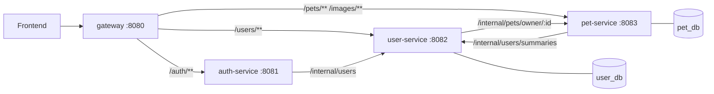
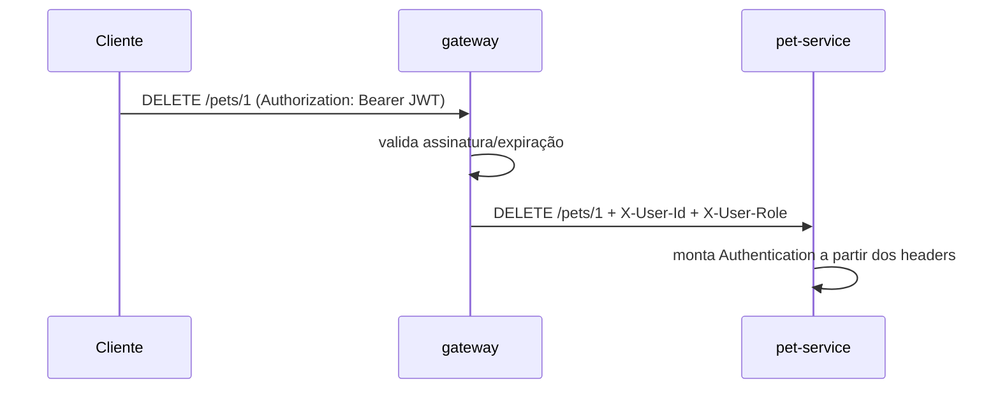
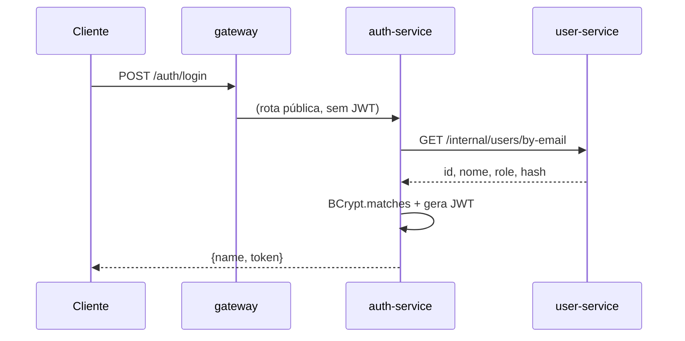

# Do monólito aos microserviços: o que mudou e por quê

Este documento explica **cada mudança** feita ao dividir o backend (`back/`, um único Spring Boot) em `gateway`, `auth-service`, `user-service` e `pet-service`, e **por que** cada decisão foi tomada daquela forma.

> **Princípio guia:** o frontend não deveria perceber a mudança. Por isso o gateway usa a porta `8080` (a mesma do monólito), os paths públicos são idênticos e o envelope de resposta (`ApiResponse`) e o formato do JWT foram mantidos.

## Sumário

1. [Visão geral](#visão-geral)
2. [Como o monólito foi dividido](#como-o-monólito-foi-dividido)
3. [Decisões que atravessam todos os serviços](#decisões-que-atravessam-todos-os-serviços)
4. [Serviço por serviço](#serviço-por-serviço)
5. [Fluxos principais](#fluxos-principais)
6. [Infraestrutura (Docker)](#infraestrutura-docker)
7. [Correções e mudanças de comportamento](#correções-e-mudanças-de-comportamento)
8. [Pontos que notei e NÃO alterei](#pontos-que-notei-e-não-alterei)
9. [Trade-offs e próximos passos](#trade-offs-e-próximos-passos)
10. [Migração dos dados existentes](#migração-dos-dados-existentes)

---

## Visão geral



| Antes (monólito) | Depois |
|---|---|
| 1 aplicação, 1 banco `pet_crud` | 4 aplicações, 2 bancos (`user_db`, `pet_db`) |
| `SecurityFilter` valida JWT e consulta o banco a cada request | Gateway valida o JWT uma vez; serviços recebem a identidade em headers |
| `AuthController` + `UserService` no mesmo processo | `auth-service` chama o `user-service` por HTTP |
| `PetModel` → `@ManyToOne` → `UserModel` | `PetEntity` guarda só o `ownerId` (UUID) |
| `cascade = REMOVE` apaga pets do usuário | `user-service` pede ao `pet-service` que apague os pets |
| CORS e rate limit dentro do backend | CORS e rate limit no gateway |

## Como o monólito foi dividido

Cada classe foi para o serviço dono do **dado** que ela manipula:

| Classe do monólito | Destino | Observação |
|---|---|---|
| `UserModel`/`UserEntity`, `UserRepository`, `UserService`, `UserController` | `user-service` | A tabela `users` agora é só dele |
| `AuthController`, `TokenService` | `auth-service` | Emite o JWT |
| `PetModel`/`PetEntity`, `PetRepository`, `PetService`, `PetController`, `PetSpecification`, `ImageController`, `ReturnImageURL`, `CachedImage` | `pet-service` | Pets e imagens |
| `SecurityFilter` (validação do JWT), `RateLimitFilter`, `CorsConfig`, `Bucket4jConfig` | `gateway` | Preocupações de borda |
| `CustomClientDetailsService` | removida | O gateway já valida o token; não há mais lookup no banco por request |
| `ValidationUtil` | dividida | Regras de usuário no `user-service`, de pet no `pet-service`, de senha no `auth-service` |

**Por que dividir por dado e não por camada?** Um microserviço deve ser dono dos seus dados e das regras sobre eles. Se `pet-service` lesse a tabela `users`, qualquer mudança no schema de usuário quebraria pets, e teríamos um "monólito distribuído". Aqui, o único jeito de um serviço obter dados de outro é por API.

## Decisões que atravessam todos os serviços

### 1. Um banco por serviço (na mesma instância Postgres)

`user_db` e `pet_db` são bancos separados no mesmo servidor PostgreSQL, criados por `db/init-databases.sh`.

- **Por quê:** isolamento de dados é o que permite evoluir/escalar/trocar cada serviço de forma independente. Sem isso, o acoplamento via banco anularia o ganho.
- **Por que uma instância só:** para um projeto de estudo, subir 2 Postgres dobraria o consumo sem ensinar nada novo. Separar bancos já impõe a regra (usuários e credenciais não se misturam). Migrar um banco para outra instância depois é só mudar `POSTGRES_URL`.
- **Consequência:** não há *foreign key* entre `pets.user_id` e `users.id`. A integridade passa a ser garantida pela aplicação (ver [exclusão de usuário](#exclusão-de-usuário)).

### 2. Autenticação: o gateway valida, os serviços confiam em headers



- O JWT mantém **exatamente** o formato antigo (HS256, issuer `estv`, `sub` = id do usuário, claim `role`). Tokens existentes e o `parseJwtRole` do frontend continuam funcionando.
- O gateway **sempre remove** `X-User-Id`/`X-User-Role` que chegam de fora antes de preencher os seus. Sem isso, qualquer cliente poderia enviar `X-User-Role: ROLE_ADMIN` e virar admin. Há teste cobrindo isso (`JwtAuthenticationFilterTest`).
- Nos serviços, o `GatewayHeaderAuthenticationFilter` apenas converte os headers em um `Authentication` do Spring Security. Assim **`@PreAuthorize("hasRole('ADMIN')")` e cia. continuam exatamente como estavam**, e o código de negócio quase não mudou.
- **Defesa em profundidade:** `user-service` e `pet-service` também aplicam suas próprias regras (`anyRequest().authenticated()`), então uma falha de roteamento no gateway não abre rotas protegidas.
- **Por que não validar o JWT em cada serviço?** Seria mais "zero trust", mas obrigaria a distribuir o segredo para todos e repetir a validação 3×. Para esta escala, validar na borda e isolar a rede interna é o padrão pragmático.
- **Por que HS256 (segredo compartilhado) e não RS256?** Mantém compatibilidade com o que existia. Com HS256, o gateway *poderia* forjar tokens (tem o mesmo segredo). Evolução natural: RS256, com o `auth-service` guardando a chave privada e o gateway só a pública (JWKS).

### 3. Comunicação síncrona via REST (`RestClient`)

Chamadas entre serviços usam `RestClient` (nativo do Spring 6.1+), sem Feign nem broker.

- **Por quê:** é a opção com menos peças e fácil de depurar. Todas as chamadas têm **timeout** (1–5 s) para que um serviço lento não derrube a cadeia.
- **API interna em `/internal/**`:** endpoints feitos para outros serviços (ex.: devolver o hash da senha para o login). **O gateway não roteia `/internal/**`**, e o filtro do gateway rejeita paths com `..`/`%2e`/`//` para ninguém "escapar" de uma rota pública até uma interna. Os serviços **não publicam portas** no host. É a rede Docker que protege essas rotas.

### 4. Sem service discovery, config server ou mensageria (por enquanto)

- **Discovery (Eureka/Consul):** no Docker Compose, o nome do serviço já é DNS (`http://user-service:8082`). Eureka só traria complexidade. Em Kubernetes, o `Service` cumpre o mesmo papel.
- **Config server:** 4 serviços com variáveis de ambiente não justificam outro componente.
- **Broker (Kafka/RabbitMQ):** o ideal para "usuário apagado → apagar pets" seria um evento, mas exige infraestrutura nova. Optei por chamada síncrona e ordem de operações segura (ver abaixo), deixando o evento como evolução.

### 5. DTOs e `ApiResponse` duplicados, sem biblioteca compartilhada

Cada serviço tem seu `ApiResponse` e seus DTOs.

- **Por quê:** uma lib `common` compartilhada reintroduz acoplamento (mudar a lib obriga rebuild/redeploy de todos). Duplicar ~10 linhas é barato. O que é *contrato* entre serviços fica explícito (`InternalUserDTOs`, `UserClientDTOs`, `UserSummary`).
- A mesma lógica vale para o `GatewayHeaderAuthenticationFilter`, copiado em `user-service` e `pet-service`. Se crescer, vira um *starter* compartilhado.

### 6. Projetos Maven independentes

Cada serviço tem seu `pom.xml`, seu `Dockerfile` e seu ciclo de build. Sem POM agregador: build, versão e deploy de um serviço não dependem dos outros.

---

## Serviço por serviço

### `gateway` (porta 8080)

**Tecnologia:** Spring Cloud Gateway (WebFlux), trem de releases `2025.0.x` (compatível com Spring Boot 3.5).

| O que faz | Como | Por quê |
|---|---|---|
| Roteamento | `RoutesConfig` (Java): `/auth/**`→auth, `/users/**`→user, `/pets/**` e `/images/**`→pet | Em Java, evita depender do prefixo de propriedades do Gateway, que mudou de nome na linha 2025.0. URLs vêm de `services.*.url` |
| CORS | `CorsWebFilter` com `CORS_ALLOWED_ORIGINS` | Antes ficava no `CorsConfig` do monólito. Centralizar evita cabeçalhos duplicados. Como é `WebFilter`, o preflight `OPTIONS` é respondido **antes** do rate limit |
| Rate limit | `RateLimitFilter` (Bucket4j + Caffeine) | Mesmo limite (10 req/min por IP), configurável. Saiu do Hazelcast distribuído porque agora há **um** ponto de entrada. Se replicar o gateway, trocar por Redis |
| JWT | `JwtAuthenticationFilter` + `PublicRoutes` | Mesma lista de rotas públicas do `SecurityConfig` antigo |

**Reativo vs MVC:** os três serviços são MVC (servlet), como o código original. O gateway é WebFlux porque o Spring Cloud Gateway tradicional é assim, e um proxy se beneficia de I/O não bloqueante (não prende uma thread por requisição lenta). Uploads de imagem passam em *streaming*, sem serem lidos em memória no gateway.

**Mudança de status:** requisição sem token a rota protegida agora retorna **401** (antes o Spring Security respondia 403 sem entry point). O frontend trata 401 e 403 igualmente.

### `auth-service` (porta 8081, sem banco)

**Responsabilidade:** `POST /auth/login` e `POST /auth/register`, emissão do JWT.

- **Stateless e sem banco:** não duplica dados de usuário. Consulta o `user-service` via `/internal/users/by-email` e cria via `/internal/users`.
- **Por que o hash da senha fica no `user-service` e não no auth?** Para ter **uma única fonte de verdade** por usuário. Se o auth tivesse a própria tabela de credenciais, o registro viraria uma transação distribuída (criar credencial *e* perfil, com compensação em caso de falha parcial). A alternativa (auth com banco próprio) é válida em escala maior, mas aqui complicaria sem ganho.
- **BCrypt no auth:** só depende de `spring-security-crypto`. Sem `spring-security-web`, não há segurança padrão bloqueando endpoints. O gateway já cuidou disso.
- **Erros do user-service são repassados:** 409 (e-mail já existe) e 400 (nome/e-mail/telefone inválido) chegam ao frontend com a mesma mensagem de antes. Se o `user-service` cair, retorna 503.

### `user-service` (porta 8082, `user_db`)

- **`UserEntity`:** sem a lista `pets` (`@OneToMany`). E-mail ganhou `unique = true`: antes só havia checagem na aplicação (sujeita a corrida), agora o banco garante.
- **API pública** (`/users/**`): mesmos endpoints e permissões do monólito (`@PreAuthorize` preservados).
- **API interna** (`/internal/users/**`): `by-email` (login), `POST` (criação; o **primeiro usuário vira ADMIN**, como antes) e `summaries` (lote `id → nome/telefone`, usado pelo pet-service).
- `summaries` é **POST com corpo** (e não GET `?ids=`) para não estourar o limite de tamanho de URL em páginas grandes.
- **Mantive MapStruct** aqui (mapper trivial, igual ao original).

#### Exclusão de usuário

O `cascade = REMOVE` do JPA não funciona entre bancos. Agora `UserService.delete`:

1. chama `pet-service` → `DELETE /internal/pets/owner/{id}`;
2. só então apaga o usuário.

**Por que nessa ordem?** Se a chamada ao `pet-service` falhar, o usuário continua existindo e o cliente pode tentar de novo (a remoção de pets é idempotente). Na ordem inversa, uma falha deixaria **pets órfãos** sem ninguém para limpá-los. Mesmo assim isso não é transação distribuída: se o passo 1 funcionar e o 2 falhar, o usuário fica sem pets até uma nova tentativa. A solução completa é *outbox* + evento (ver próximos passos).

### `pet-service` (porta 8083, `pet_db`)

- **`PetEntity.ownerId` (UUID):** substitui o `@ManyToOne UserModel`. A coluna continua `user_id`, então os dados antigos migram sem renomear nada. Há índice nela.
- **Dono vindo de outro serviço:** a resposta de pet inclui `owner {name, number}`. A cada página, o serviço coleta os `ownerId`s distintos e faz **uma** chamada em lote ao `user-service` (evita o problema de N+1 chamadas).
- **Degradação graciosa:** se o `user-service` estiver fora, a listagem **não falha**: os pets voltam sem `owner` (o tipo no frontend já é opcional) e um aviso vai para o log. A home é pública e não deveria cair por causa de um serviço auxiliar.
- **Alternativas consideradas:** *(a)* copiar nome/telefone para a tabela de pets: dados ficariam desatualizados quando o usuário editasse o perfil; *(b)* compor no gateway: coloca lógica de negócio na borda.
- **Quem é o dono ao criar um pet:** vem do `X-User-Id` (token). Antes o serviço buscava o usuário no banco pelo e-mail; agora não precisa de consulta nenhuma.
- **Imagens:** continuam no cache Hazelcast em memória, como antes (o mapa `rateLimiter` foi removido). O link da imagem agora é montado a partir de `PUBLIC_BASE_URL` (URL pública do gateway), e **não** do `Host` da requisição, porque o pet-service enxerga `pet-service:8083` e headers `X-Forwarded-*` podem ser forjados por clientes (envenenando URLs gravadas no banco).
- **Mapper manual** (antes MapStruct): o dono vem de outra origem, então o mapeamento recebe `UserSummary` explicitamente. Fica mais claro do que forçar o MapStruct. É fácil de reverter se preferir.
- **`PetNotFoundException` → 404** (antes `RuntimeException` → 500).
- **`/internal/pets/owner/{ownerId}`:** usado na exclusão de usuário.

---

## Fluxos principais

**Login**



**Listagem pública de pets** — `GET /pets` → gateway (público) → pet-service lê `pet_db` → 1 chamada em lote ao user-service → resposta com `owner` (ou sem, se o user-service estiver fora).

**Exclusão de usuário** — `DELETE /users/{id}` → gateway (JWT) → user-service → `DELETE /internal/pets/owner/{id}` no pet-service → apaga o usuário.

## Infraestrutura (Docker)

| Mudança | Motivo |
|---|---|
| Um `Dockerfile` por serviço (multi-stage, usuário não-root, como o original) | Build e imagem independentes por serviço; `finalName` fixo evita adivinhar o nome do JAR |
| `docker-compose.yml`: 5 serviços + Postgres; só `gateway` (8080), `frontend` e `postgres` publicam porta | Rede interna protege `/internal/**` |
| `healthcheck` com `/actuator/health` e `depends_on: service_healthy` | Ordem de subida correta: Postgres → user/pet → auth → gateway. Só `health` é exposto |
| `db/init-databases.sh` no lugar de `init.sql` | Cria um banco por serviço. O `GRANT` do `init.sql` virou desnecessário (o usuário é dono dos bancos) |
| `.env`: removido `POSTGRES_DB`/`POSTGRES_URL`; adicionados `USER_DB`/`PET_DB` | Cada serviço tem seu banco; a URL JDBC é montada no compose |
| Imagem única (`Dockerfile`, `supervisord.conf`, `entrypoint.sh`) atualizada | Roda 4 JVMs + Postgres + Nginx; Nginx aponta para o gateway (`127.0.0.1:8080`, sem mudar o `nginx.conf`). `-Xmx` por serviço para limitar memória |
| Frontend **sem alterações** | O gateway assumiu a porta 8080 |

## Correções e mudanças de comportamento

A refatoração foi, na medida do possível, *behavior-preserving*. Estes são os pontos em que o comportamento **mudou** (todos intencionais):

1. **Validação de senha agora funciona.** No monólito, `validateUser` checava `password.length() < 8` **depois** do BCrypt (hash sempre tem 60 caracteres), então nunca falhava. Agora o `auth-service` valida a senha em texto puro antes do hash. **Senhas com menos de 8 caracteres passam a ser recusadas no registro** (era a intenção declarada pela mensagem de erro).
2. **Expiração do JWT.** O código antigo fazia `LocalDateTime.now().plusHours(2).toInstant(ZoneOffset.of("-03:00"))`, correto só se o servidor estivesse em UTC-3. Em container UTC, o token durava 5 h. Agora usa `Instant.now().plus(...)` (2 h reais), configurável por `JWT_EXPIRATION_HOURS`.
3. **`PUT /pets/{id}` não vaza mais o hash da senha.** Antes retornava a entidade `PetModel`, que serializava `owner` → `UserModel`, incluindo `password`. Agora retorna `PetResponse`. Também devolve o pet com `owner {name, number}`.
4. **`PUT /pets/{id}` atualiza todos os campos explicitamente** (incluindo `type` e `gender`). O `BeanUtils.copyProperties` antigo com `record` + enums de tipos diferentes provavelmente não copiava esses campos.
5. **`PUT /users/{id}` retorna `UserResponse`** (sem campo `password: null`).
6. **Sem token → 401** (antes 403); **429** com o mesmo envelope `ApiResponse`; **pet inexistente no update → 404** (antes 500); preflight `OPTIONS` não conta no rate limit.
7. **E-mail único no banco** (`unique = true`) e `409` também em caso de corrida.

## Pontos que notei e NÃO alterei

Preferi não misturar correções de regra de negócio com a mudança de arquitetura, mas vale resolver:

- **Autorização frouxa (IDOR).** `DELETE /users/{id}`, `DELETE /pets/{id}` e `PUT /pets/{id}` aceitam qualquer usuário autenticado, sem checar se o recurso é dele (`hasAnyRole('USER','ADMIN')`). Qualquer usuário logado pode apagar outro usuário ou pet. Agora ficou fácil corrigir: o `AuthenticatedUser` (id e papel) já chega ao serviço. Sugestão: permitir se `user.id().equals(ownerId)` ou `ADMIN`.
- **`PUT /users/{id}` exige ADMIN** (herdado do `findById` antigo, que era `@PreAuthorize("hasRole('ADMIN')")`), então um usuário comum não consegue editar o próprio perfil.
- **`PetSpecification` compara `age`/`weight` (colunas `String`) com `Integer`**, o que provavelmente falha no Hibernate 6 ao filtrar por esses campos. Mantido como estava.
- **`ValidationUtil.validatePet` assume `age`/`weight`/`race` não nulos** (NPE → 500 se o cliente omitir).
- **Imagens só em memória (Hazelcast).** Reiniciar o `pet-service` perde as imagens, e `imageUrl` no banco passa a dar 404. Para produção: S3/MinIO ou banco.
- **`SECRET_KEY` fraca** no `.env` (`mykey`) e default `mySecretKey123` no compose. Para HS256 use ≥ 32 bytes aleatórios.
- **Primeiro usuário = ADMIN** tem corrida teórica (dois registros simultâneos no banco vazio).
- **Spring Cloud 2025.0.x** teve o suporte open source encerrado em 30/06/2026 (segundo o anúncio da última release, 2025.0.3). Vale conferir também o ciclo de suporte do Spring Boot 3.5 e planejar a subida para uma linha mais nova de Boot/Cloud.

## Trade-offs e próximos passos

**O que se perde com microserviços** (e isso é esperado): latência extra por chamada de rede, consistência eventual em vez de transação única (ex.: exclusão de usuário), mais coisas para operar e observar, e debug mais difícil.

Próximos passos naturais, em ordem de valor:

1. Corrigir a autorização por dono (item acima).
2. **Resiliência:** Resilience4j (circuit breaker, retry) nos `RestClient`s e timeouts no `HttpClient` do gateway.
3. **Evento `UserDeleted`** (RabbitMQ/Kafka + outbox) no lugar da chamada síncrona.
4. **Observabilidade:** *correlation id* propagado pelo gateway, logs estruturados, Micrometer/OpenTelemetry.
5. **JWT RS256/JWKS** e segredos fora do `.env`.
6. **Testes de contrato** (Spring Cloud Contract/Pact) para `/internal/**` e Testcontainers para os serviços com banco.
7. **Imagens** em storage de objetos.
8. Rate limit distribuído (Redis) se o gateway for replicado.

## Migração dos dados existentes

Se você já tem dados no banco do monólito (`pet_crud`), o script `init-databases.sh` **não** roda de novo (o volume já existe). Duas opções:

**A) Recomeçar do zero:** `docker compose down -v && docker compose up --build`.

**B) Copiar os dados:**

```bash
docker compose up -d postgres
docker compose exec postgres psql -U meuuser -d postgres \
  -c "CREATE DATABASE user_db" -c "CREATE DATABASE pet_db"

docker compose exec postgres sh -c "pg_dump -U meuuser -d pet_crud -t users --no-owner | psql -U meuuser -d user_db"
docker compose exec postgres sh -c "pg_dump -U meuuser -d pet_crud -t pets  --no-owner | psql -U meuuser -d pet_db"
# O pg_dump de "pets" inclui a FK para "users", que não existe em pet_db: esse único erro é esperado e pode ser ignorado.

docker compose up --build
```

Os nomes de coluna são os mesmos (`user_id`, `created_at`, `image_url`...), então nada precisa ser renomeado. As imagens, que já viviam só em memória, não são migradas.

## Importante: o que foi e o que não foi verificado

Este refatoramento foi escrito num ambiente **sem acesso ao Maven Central**, então **o build e os testes não foram executados**. Foi feita uma verificação sintática de todos os arquivos Java (`javac`), e a revisão de contratos entre serviços foi manual. Antes de confiar, rode:

```bash
for s in gateway auth-service user-service pet-service; do (cd back/$s && mvn -q verify) || break; done
docker compose up --build
```

Os testes antigos do monólito não foram portados: dependiam de um único contexto Spring (H2 + `MockMvc` sobre todos os controllers) e alguns já estavam desatualizados em relação ao código. Foram substituídos por testes unitários por serviço, focados no que mudou (headers de identidade e rate limit no gateway, emissão de JWT, ordem de exclusão de usuário e degradação quando o `user-service` cai).
